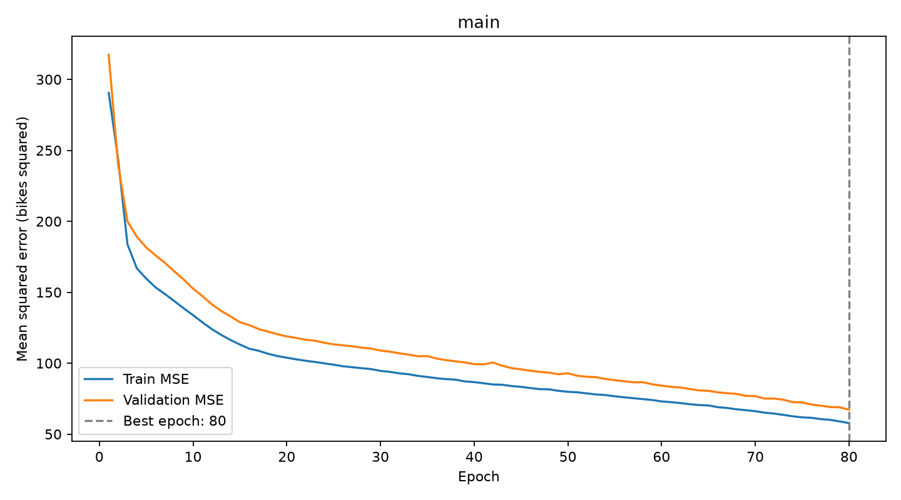
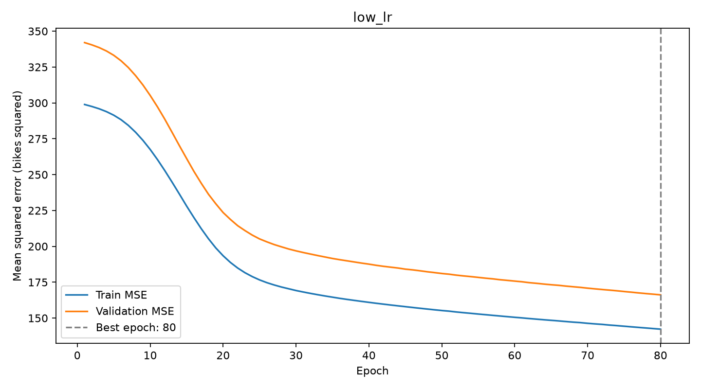
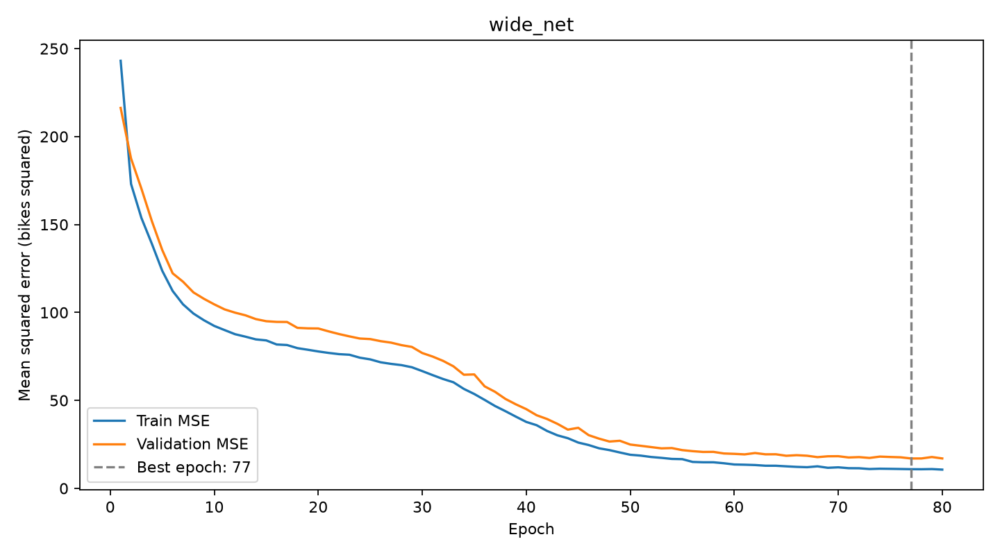

# Lakeshore Bike Demand

## What it does

This project predicts the number of bicycles rented from a station during an hour using a feedforward neural network built in PyTorch.

The business objective is to help Lakeshore Bike Share planners estimate rental demand and support bicycle-repositioning decisions.

The project builds a neural network with a custom Dataset, DataLoaders and a handwritten training loop. It compares the neural network against two simpler baselines: the training mean and linear regression.

The goal is to determine whether nonlinear modelling provides additional predictive value.

## How to run it

Create and activate the Conda environment:

```
conda env create -f environment.yml
conda activate lab07-first-principles
```

Generate the results and figures:

```
python train.py
```

Run the required quality checks:

```
python -m ruff format --check .
python -m ruff check .
python -m pytest
```

The training script automatically generates the evaluation reports, experiment results and learning curves in the `reports/` folder.

## Data and split

The dataset contains **6,000 synthetic station-hour observations**, generated using the supplied `bikes_data.py` file with seed 2026.

There are six original input variables:

| Feature | Description |
|---|---|
| `hour` | Hour of day (0–23) |
| `temperature_c` | Temperature in Celsius |
| `rain_mm` | Rainfall |
| `wind_kph` | Wind speed |
| `is_weekend` | Weekend indicator (0 or 1) |
| `station_type` | Downtown, residential or park |

The target variable is **`rentals`**, representing the number of bikes rented during the hour.

### Data splitting

The data are divided using `random_state=42`:

| Dataset | Observations | Percentage | Purpose |
|---|---:|---:|---|
| Training | 3,600 | 60% | Learn model parameters |
| Validation | 1,200 | 20% | Compare experiments and select the model |
| Test | 1,200 | 20% | Evaluate the final selected model |

### Preprocessing

The preprocessing pipeline uses:

- `StandardScaler` to standardize five numerical features.
- `OneHotEncoder` to convert station type into three binary features.
- `torch.float32` tensors for neural-network training.
- A custom PyTorch Dataset and DataLoaders for batch processing.

Preprocessing produces **eight numerical input features**.

To prevent data leakage, the scaler and encoder are fitted only on training data. The fitted transformations are then applied to validation and test data.

Training batches are shuffled using a seeded generator. Validation and test batches are not shuffled.

## Model and training

The neural network is defined in `model.py` using PyTorch's `nn.Module`.

The main model architecture is:

**8 inputs → 32 hidden neurons → ReLU → 32 hidden neurons → ReLU → 1 output**

The final layer has no activation function because the task is regression, not probability classification.

### Main training configuration

| Parameter | Value |
|---|---|
| Hidden layers | 2 |
| Hidden neurons per layer | 32 |
| Activation function | ReLU |
| Loss function | Mean Squared Error (MSE) |
| Optimizer | Adam |
| Learning rate | 0.001 |
| Training batch size | 64 |
| Epochs | 80 |
| Random seed | 42 |

### Training loop

The handwritten training loop follows five main steps:

1. **Batch:** Read observations and targets from the DataLoader.
2. **Forward:** Generate predictions using `model(x)`.
3. **Loss:** Calculate prediction error using `nn.MSELoss()`.
4. **Backward:** Compute gradients using `loss.backward()`.
5. **Step:** Update model weights using `optimizer.step()`.

The loop calls `optimizer.zero_grad()` before calculating gradients to prevent unintended accumulation.

Training loss, training MAE, validation loss and validation MAE are recorded for every epoch.

The model weights from the epoch with the **lowest validation MSE** are restored after training.

The final configuration is selected using validation MAE at the restored best-loss epoch. The test dataset is evaluated after this selection.

## Results

Model performance is measured using **Mean Absolute Error (MAE)**.

MAE represents the average absolute difference between actual and predicted rental counts:

**MAE = Average |Actual Rentals − Predicted Rentals|**

A lower MAE indicates more accurate predictions.

### Model comparison

| Model | Validation MAE | Test MAE |
|---|---:|---:|
| Training mean | 10.154 | 9.649 |
| Linear regression | 9.317 | 8.573 |
| **Selected neural network** | **2.748** | **2.623** |

All MAE values are measured in bikes rented per station-hour observation.

### Key findings

The selected neural network achieved the lowest prediction error among the three models.

On the held-out test dataset:

- Training-mean baseline MAE: **9.649 bikes**
- Linear regression MAE: **8.573 bikes**
- Neural network MAE: **2.623 bikes**

The neural network achieved approximately **69.4% lower test MAE** than linear regression.

This result demonstrates that nonlinear modelling offers substantial predictive benefits for the synthetic bike-rental dataset.

### Why linear regression performs worse

Rental demand is influenced by nonlinear relationships involving time of day, weather conditions, weekends and station type.

For example, downtown demand may peak during commuting hours, while park stations may experience stronger activity during suitable weekend conditions.

A basic linear regression model cannot automatically capture these nonlinear relationships and interactions without additional feature engineering.

The neural network uses hidden layers and ReLU activation functions to learn more complex patterns.

### Learning curves



The main model's training and validation losses decrease over the 80 training epochs.

At epoch 80:

- Final training MSE: **57.803**
- Final validation MSE: **67.313**
- Validation MAE: **5.335 bikes**

Both losses improved during training, without evidence of a substantial late-stage increase in validation error.

Because the lowest validation loss occurred at epoch 80, the model had not reached a clearly identified earlier stopping point within the experiment.

The results suggest that the main network may benefit from greater capacity or additional training. The wider-network experiment evaluates the capacity hypothesis.

## Experiments

Three experiments were conducted to understand how learning rate and network capacity affect performance.

Each additional experiment changes **one parameter at a time** relative to the main model.

| Run | Best epoch | Validation MAE at best epoch | Final training MSE | Final validation MSE |
|---|---:|---:|---:|---:|
| Main | 80 | 5.335 | 57.803 | 67.313 |
| Low learning rate | 80 | 8.495 | 142.276 | 166.199 |
| **Wider network** | **77** | **2.748** | **10.643** | **16.998** |

The best epoch is selected using validation MSE. The reported validation MAE is measured at that epoch.

### Experiment 1 — Low learning rate

**Configuration:** 32 hidden neurons, learning rate 0.0001, 80 epochs.



This experiment reduces the learning rate from 0.001 to 0.0001 while keeping the architecture and epoch count unchanged.

Results:

- Best epoch: 80
- Validation MAE: 8.495 bikes
- Final training MSE: 142.276
- Final validation MSE: 166.199

Compared with the main model, the lower learning rate produced higher prediction errors.

The training and validation losses remained relatively high after 80 epochs, indicating slower optimization.

**Interpretation:** A very small learning rate can make model training too slow within a fixed training budget.

### Experiment 2 — Wider network

**Configuration:** 128 hidden neurons per layer, learning rate 0.001, 80 epochs.



This experiment increases hidden-layer width from 32 to 128 neurons while keeping the learning rate and number of epochs unchanged.

Results:

- Best epoch: 77
- Best validation MSE: 16.980
- Validation MAE at best epoch: 2.748 bikes
- Final training MSE: 10.643
- Final validation MSE: 16.998

The wider network substantially outperformed the main and low-learning-rate configurations.

Its validation loss was lowest at epoch 77 and increased only slightly by epoch 80.

The gap between training and validation loss indicates some difference in performance between the two datasets, but the small late increase in validation loss does not establish severe overfitting.

**Interpretation:** Increasing network capacity helped the model learn the nonlinear demand relationships more effectively.

### Experiment comparison

The results demonstrate that:

1. A low learning rate may slow model learning.
2. Additional network capacity can improve performance.
3. Training and validation curves reveal learning behavior.
4. Model selection should be based on validation results rather than test performance.

The wider network was selected because it had the lowest validation MAE at its best validation-loss epoch.

## Conclusion

The project successfully implemented a PyTorch neural network with a handwritten training loop and compared it with two baseline models.

Among the three network configurations tested, the wider network performed best.

The selected network achieved a **test MAE of 2.623 bikes**, compared with 8.573 bikes for linear regression and 9.649 bikes for the training-mean baseline.

This corresponds to approximately a **69.4% reduction in test MAE relative to linear regression**.

The results support three conclusions:

1. Nonlinear modelling provided significant predictive value for this simulated dataset.
2. Learning rate and network architecture materially affected model performance.
3. Validation-based selection, baseline comparisons and reproducible experiments are essential for credible machine-learning results.

From a business perspective, better hourly demand forecasts could support more informed bicycle-repositioning and station-capacity decisions.

However, operational improvements and cost savings have not been measured in this project.

## Limitations

The dataset is synthetic and does not represent verified real-world bicycle rental activity.

The model does not include every factor that could affect actual demand, including holidays, special events, station capacity, bike availability or maintenance.

The network has an unrestricted regression output. It may produce negative or fractional predictions, even though actual rentals are nonnegative integers.

The dataset does not contain a true chronological observation-date field, so the assignment uses a seeded random split rather than chronological forecasting validation.

Performance on synthetic data does not guarantee equivalent accuracy on real-world observations.

Before operational use, the model would require validation on actual rental records, monitoring for changes in demand patterns, and assessment of how prediction errors affect repositioning decisions.

The model should therefore be considered a learning and evaluation project rather than a production-ready bicycle-repositioning system.